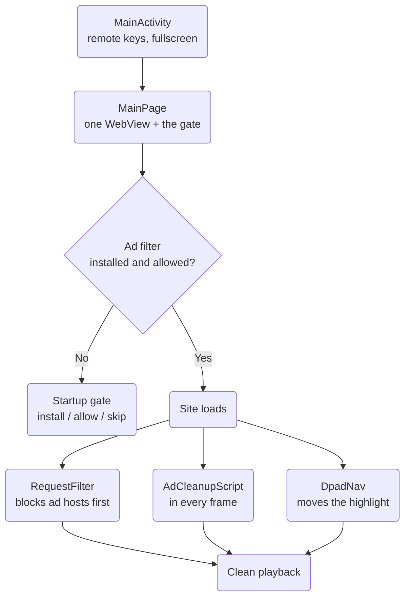

# Un0Tv

**A remote-first Android TV shell for [secondframe](https://secondframe.netlify.app/).**

Un0Tv wraps one web app in a full-screen, D-pad driven Android TV experience. The site itself was built for phones: it expects swipes, has no TV navigation, and serves its films through third-party players covered in adverts. Un0Tv bridges that gap on the TV side, inside one app and without a VPN.

<p align="center">
  
  
  
  
</p>

---

## Contents

- [What it does](#what-it-does)
- [How it is put together](#how-it-is-put-together)
- [The advert problem, layer by layer](#the-advert-problem-layer-by-layer)
- [Project layout](#project-layout)
- [Requirements](#requirements)
- [Build and run](#build-and-run)
- [Release builds and signing](#release-builds-and-signing)
- [Installing on a TV](#installing-on-a-tv)
- [Remote controls](#remote-controls)
- [Versioning](#versioning)
- [Known limits](#known-limits)

---

## What it does

| Feature | Behaviour |
|---|---|
| **TV launcher** | Declares `LEANBACK_LAUNCHER` and ships a TV banner, so Un0Tv appears on the Android TV home screen, not just in the apps list. |
| **Always landscape** | The activity is locked to landscape with the light bar hidden and the screen kept awake. |
| **Startup ad-filter check** | Before the site opens, the app checks that the TV's own filter app is installed and allowed to run, then takes you straight to the right screen if it is not. |
| **D-pad navigation** | The remote's arrows move a moving highlight over the site's clickable items; the centre button presses the highlighted one. |
| **Advert filtering** | Two independent layers: a host filter on every network request, and an in-page cleaner that runs inside every frame, including the movie player's own. |
| **Pop-up policy** | The movie player's "can I open a pop-up?" check passes silently, while advert windows are refused and sign-in windows are allowed. |
| **Auto play** | Landing on a watch page presses the site's own play control, then lifts the mute so the film starts with sound. |
| **Back button** | Leaves fullscreen, closes a sign-in window, or steps one page back inside the site, before it ever closes the app. |

---

## How it is put together



The app is deliberately thin. It is **one page, one browser, and a handful of Android-side helpers**. There is no native re-render of the site, no scraping and no mirroring, so whatever the site shows is what you see.

---

## The advert problem, layer by layer

Adverts reach a streaming page through four different doors. Un0Tv closes them separately, because no single trick closes them all.

### 1. Advert hosts at the network level

`RequestFilter.cs` sits in front of every request the page **or a movie player** makes, and answers blocked hosts with an empty reply so the script never arrives. Roughly 300 host names are listed, covering ad exchanges, pop-unders, trackers, fingerprinting, coin-miners and fake "your device is infected" pages.

Two rules keep it safe:

- **A keep list always wins.** The site, its sign-in, the movie players and their video hosts are never blocked.
- **Whole host names only, never plain words.** `adserver.com` is blocked; a film titled *Shadow* is not.

### 2. Advert windows

The player runs a pop-up capability check by asking for a blank 1x1 window. The app hands that check a harmless stand-in so it passes quietly, opens real windows for Google, Firebase and the site's own sign-in, and refuses everything else.

### 3. Advert overlays inside the player

This is the hard one. The QR walls and "confirm you are not a robot" covers are **drawn by the movie player itself**, inside its own frame, where the page's own scripts cannot reach. `AdCleanupScript.cs` is registered to run in **every frame at page start**, so it sees the cover as it is built. It closes the cover using its own X or skip control, and never touches anything holding the video.

### 4. Sound and fullscreen

Browsers only allow a video to start by itself while it is muted, so the player begins silent. The app permits sound-on start and lifts the mute inside the player at the moment it is set. Fullscreen is passed through to Android, and **Back** always leaves fullscreen before it does anything else.

> **Note:** a QR or logo burned into the video picture by the source cannot be removed by any app. Only choosing a different source helps.

---

## Project layout

```
Un0Tv/
├── MainPage.xaml / .xaml.cs        One page: the browser plus the startup gate
├── PageScripts.cs                  Auto play script injected after each load
├── DpadNav.cs                      The moving highlight and its arrow logic
├── version.json                    Base version for Nerdbank.GitVersioning
└── Platforms/Android/
    ├── MainActivity.cs             Remote keys, fullscreen, Back, keyboard detection
    ├── AndroidManifest.xml         TV features, banner, package queries
    ├── BlockerGate.cs              Is the TV ad filter installed and allowed?
    ├── TvWebView.cs                Native view setup, pop-up window, fullscreen
    ├── TvChromeClient.cs           Pop-up routing, fullscreen callbacks
    ├── TvWebViewClient.cs          Request hook for the filter
    ├── RequestFilter.cs            Host block list and keep list
    ├── PopupGuard.cs               Which pop-up windows are allowed
    ├── AdCleanupScript.cs          In-frame advert cleaner
    └── AudioAutoplay.cs            Sound-on autoplay inside the player
```

---

## Requirements

| Item | Version |
|---|---|
| .NET SDK | 10.0 (MAUI workload installed) |
| Android SDK | API 36 build tools, platform `android-36` |
| JDK | 17 |
| Target device | Android TV or Google TV, Android 5.0 (API 21) or newer |

> Samsung (Tizen) and LG (webOS) televisions cannot run this app. It needs Android underneath.

### Packages

| Package | Why it is here |
|---|---|
| `Microsoft.Maui.Controls` | The app framework |
| `Microsoft.Extensions.Logging.Debug` | Debug logging |
| `Octokit` | GitHub API client, kept for tooling and future release checks |
| `Nerdbank.GitVersioning` | Stamps the app version from git history |
| `Xamarin.AndroidX.WebKit` | Lets the app run a script inside **every frame**, which is what makes the in-player cleaner possible. Pinned to `1.11.0.5` to stay on Android 5.0 |

---

## Build and run

```powershell
# Debug, straight to a connected TV or emulator
dotnet build -f net10.0-android -c Debug

# Signed release APK, all chip types in one file
dotnet publish -f net10.0-android -c Release
```

The installable file lands in:

```
Un0Tv/bin/Release/net10.0-android/publish/com.DevLink.Un0tv-Signed.apk
```

The project builds for three Android chip types at once (`arm64-v8a`, `armeabi-v7a`, `x86`), so a single APK covers modern TVs, older 32-bit boxes and the emulator. Restricting to one chip type produces a smaller file but an APK that some TVs refuse with *"App not installed"*.

> **If a build fails with** `System.IO.IOException: The directory is not empty`, an earlier build is still holding files. Run `dotnet build-server shutdown`, then build again.

---

## Release builds and signing

Release APKs are signed with your own key, not the throwaway debug key. The key and its passwords live in files that are **kept out of source control**:

| File | Purpose | In git? |
|---|---|---|
| `Un0Tv/un0tv.keystore` | The signing key | **No** |
| `Un0Tv/signing.props` | Key passwords and alias | **No** |

`Un0Tv.csproj` imports `signing.props` only for **Android + Release**, so Debug builds never touch your real key. If that file is missing, Release still builds, but falls back to the debug key.

To create a key from scratch:

```powershell
keytool -genkeypair -v -keystore un0tv.keystore -alias un0tv `
        -keyalg RSA -keysize 2048 -validity 10000
```

**Keep this file forever.** Every future update must be signed with the same key, or the TV will refuse it as an update to the installed app.

---

## Installing on a TV

### Over the network (recommended)

```powershell
adb connect <TV-IP>:5555
adb install "Un0Tv/bin/Release/net10.0-android/publish/com.DevLink.Un0tv-Signed.apk"
```

Turn on developer mode on the TV first: **Settings → System → About → click Build seven times**, then **Settings → System → Developer options → Network debugging**.

### Without a cable or ADB

Copy the APK to a USB stick and open it with a file manager on the TV, or install the *Downloader* app on the TV and point it at the file.

If the TV says **"App not installed"**:

1. Turn on **Install unknown apps** for the app doing the installing.
2. Confirm the TV is Android TV or Google TV, not Tizen or webOS.
3. Confirm the APK carries the TV's chip type (`arm64-v8a` or `armeabi-v7a`).
4. Run `adb install` instead of tapping the file. It prints the real reason the vague message hides.

---

## Remote controls

| Key | What happens |
|---|---|
| **Up / Down / Left / Right** | Moves the highlight to the nearest clickable item in that direction |
| **Center / Enter** | Presses the highlighted item |
| **Back** | Leaves fullscreen, or closes the sign-in window, or steps back one page, or exits the app |

The startup gate uses Android's own focus movement, so the D-pad works there in the normal TV way.

---

## Versioning

`version.json` holds the base version (`1.0`), and `Nerdbank.GitVersioning` reads the git history to expand it into a real build number. Android needs two numbers, and both must climb on every install or the TV treats the new file as the same old app:

| Android setting | What it means |
|---|---|
| `ApplicationDisplayVersion` | The version you see, for example `1.0.8` |
| `ApplicationVersion` | A whole number that must increase on every install |

> **Status:** the package is installed and `version.json` exists, but the two numbers in `Un0Tv.csproj` are still hand-typed (`1.0` and `1`). They are not yet driven by the package, so bump them by hand until that wiring is finished.

---

## Known limits

- **The player's own frame cannot be styled.** The site is never redrawn natively, so its layout on a TV is exactly the layout a phone browser would get.
- **Advert covers change.** The in-frame cleaner works by matching wording, corners and shapes. A cover with entirely new wording can slip through until it is added.
- **The ad filter app's switch is not automatic.** Android will not let one app turn on another app's filter. The startup gate verifies it and opens the right screen; the final toggle is yours to press.
- **Burning-in is forever.** A logo or QR encoded into the video picture itself is part of the film, so no layer can remove it.
- **Only one site.** The address lives in `MainPage.xaml.cs` as `SiteUrl`. The scripts that press play and clean covers are tuned to that site's markup.

---

<p align="center"><sub>Un0Tv · built for a remote, not a thumb</sub></p>
