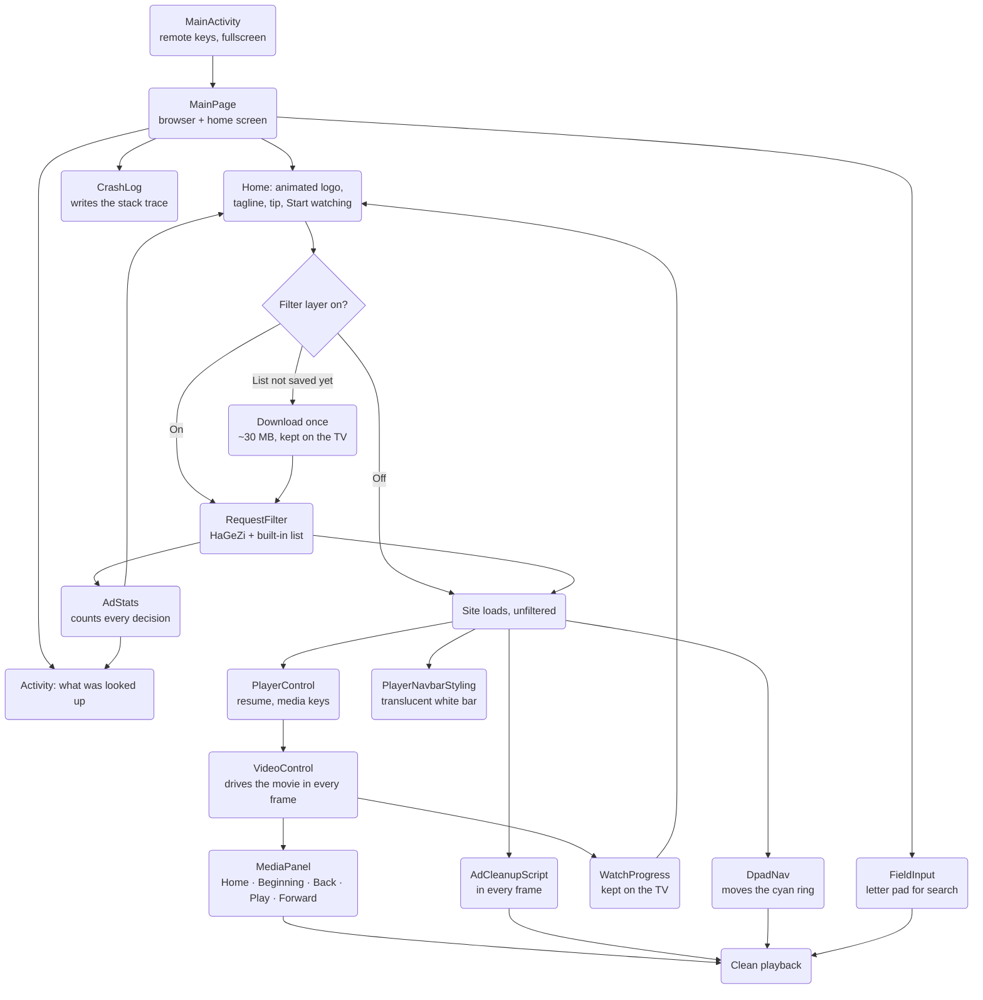

# Un0Tv

**A remote-first Android TV shell for a website.**

Un0Tv wraps one web app in a full-screen, D-pad driven Android TV experience. The site itself was built for phones: it expects swipes, has no TV navigation, and serves its films through third-party players covered in adverts. Un0Tv bridges that gap on the TV side, inside one app and without a VPN.

<p align="center">
  
  
  
  
  
  
</p>

> **Tested on a Sony Android TV.** The builds described here were installed and run on a real Sony Android TV — the TV launcher entry, the startup home screen, the cyan D-pad highlight, the advert filtering and playback all work there.

---

## Contents

- [What it does](#what-it-does)
- [The cyan cursor](#the-cyan-cursor)
- [How it is put together](#how-it-is-put-together)
- [The advert problem, layer by layer](#the-advert-problem-layer-by-layer)
- [Project layout](#project-layout)
- [Requirements](#requirements)
- [Build and run](#build-and-run)
- [Release builds and signing](#release-builds-and-signing)
- [Installing on a TV](#installing-on-a-tv)
- [Remote controls](#remote-controls)
- [Versioning](#versioning)
- [Known limits](#known-limits)

---

## What it does

| Feature | Behaviour |
|---|---|
| **TV launcher** | Declares `LEANBACK_LAUNCHER` and ships a TV banner, so Un0Tv appears on the Android TV home screen, not just in the apps list. |
| **Always landscape** | The activity is locked to landscape with the light bar hidden and the screen kept awake. |
| **Home screen** | The launch screen: an animated Un0 logo whose glow breathes and sways, the line *"Your TV's gateway to global cinema"*, a **Peak Performance Tip** about keeping the TV on a fast, un-congested network, the one **Start watching** button a viewer needs, and the app's version underneath. |
| **Activity log** | Reached with **Back** from the home screen: what was looked up and whether it got through, newest first, with an All / Blocked tab. |
| **Cyan cursor** | A bright cyan ring that walks the site's own controls with the remote's arrows: the top navigation, the category chips, the movie cards, the page numbers, the search box and the profile. |
| **Scroll on Home** | Pressing Down past the last item scrolls the page — including the site's own inner scroller — so the rows below are reachable. |
| **Number keys** | Pressing **1**–**9** or **0** jumps the ring straight to that numbered item on screen. |
| **Watch progress** | The player reports its time, the app saves it on the TV, and the same title resumes where the viewer stopped. |
| **Continue watching** | The home screen shows the last titles left part way through; pressing one reopens the title and seeks to the saved spot. The site's own library keeps its own history, so nothing is drawn over it. |
| **Media keys** | **Play**, **Pause**, **Play/Pause**, fast-forward and rewind on the remote drive the movie directly inside the player's own frame, even when it is nested two frames deep. |
| **Movie panel** | **Left** on a movie opens a small panel with **Home**, **Beginning**, **Back 10s**, **Play/Pause**, **Forward 10s** and **Next** — real buttons the D-pad can reach, since the player's own controls sit in a frame the app cannot focus. It closes itself after a few seconds so nothing covers the picture. |
| **Search typing** | OK on the magnifier opens the site's search bar and raises the TV's own keyboard; if the TV has none, the app raises its own letter pad — a translucent white keyboard at 30% opacity — which the D-pad always reaches. |
| **Player styling** | The movie player's own navigation bar is restyled to translucent white, so it matches the rest of the app instead of the site's dark look. |
| **Advert filtering** | Three layers: HaGeZi's Multi PRO list (~214,000 domains) plus a built-in host list on every network request, and an in-page cleaner that runs inside every frame, including the movie player's own. |
| **Pop-up policy** | The movie player's "can I open a pop-up?" check passes silently, while advert windows are refused and sign-in windows are allowed. |
| **Auto play** | Landing on a watch page presses the site's own play control, then lifts the mute so the film starts with sound. |
| **Crash log** | If anything ever goes wrong, the full stack trace is written to `crash.log` in the app's files folder, so the cause can be read back without a cable. |

---

## The cyan cursor

The site was built for a thumb, so Un0Tv draws its own ring over the page and moves it with the remote. The ring only ever lands on things a viewer wants:

| Where it goes | How it is recognised |
|---|---|
| **Top navigation** | Home, Movies, TV Shows, Browse All, Continue |
| **Category chips** | Trending, Popular, Top Rated, Upcoming, On Air, Anime, Action, Horror, Comedies, Fantasy, Dramas, Crime — and any short chip sitting in a category or filter row, whatever the site called it |
| **Movie cards** | Poster cards and search-result cards, including the ones the site paints as a CSS background instead of an `` |
| **Page numbers** | The pagination buttons under a movie list (1, 2, … 500) |
| **Search** | The search box, and the magnifier icon that opens it |
| **Profile** | The avatar and anything inside the profile menu |

A few deliberate exclusions: the round numbered badges on the sign-in page are **not** selectable, and the ring **hides itself after about 2.5 seconds** of an untouched remote, so the picture is never marred by a ring nobody is using.

Pressing a top-nav tab keeps the ring **on that tab** after the page re-renders, so the viewer never loses their place.

---

## How it is put together



The app is deliberately thin. It is **one page, one browser, and a handful of Android-side helpers**. There is no native re-render of the site, no scraping and no mirroring, so whatever the site shows is what you see.

> **Note:** there is no built-in native video player. Movies play inside the site's own player, inside the app — which keeps the app stable and keeps every filter and progress feature working on the same stream.

---

## The advert problem, layer by layer

Adverts reach a streaming page through four different doors. Un0Tv closes them separately, because no single trick closes them all.

### 1. Advert hosts at the network level

`RequestFilter.cs` sits in front of every request the page **or a movie player** makes, and answers blocked hosts with an empty reply so the script never arrives. It matches against two lists:

- **HaGeZi's Multi PRO** — about **214,000** advert, tracker, phishing and malware domains. Downloaded once (around 30 MB) and kept on the TV, so later starts load it from disk in a second.
- **A built-in short list** — around 300 host names covering the worst ad exchanges, pop-unders and fake "your device is infected" pages. This one works even before anything is downloaded.

Two rules keep it safe:

- **A keep list always wins.** The site, its sign-in, the movie players and their video hosts are never blocked.
- **Whole host names only, never plain words.** `adserver.com` is blocked; a film titled *Shadow* is not. A subdomain such as `a.b.adsite.com` is caught by an entry for `adsite.com`, which is how the wildcard list is meant to work.

The home screen has three layer buttons, the way Repel lays out its protection:

| Layer | Button | What it does |
|---|---|---|
| **Ad and tracker filter** | `ON` / `OFF` | Turns the app's own filtering on or off. Off means nothing is filtered at all — handy if a film refuses to start and you want to rule the blocker out. |
| **HaGeZi Multi PRO list** | `Get` / `Update` | Fetches the ~214,000-domain list (around 30 MB, kept on the TV), or refreshes it later. |
| **Private DNS** | `Open` | Opens the app's presets screen: eight resolvers (AdGuard, NextDNS, Mullvad, Quad9 and more). Where Android allows it, the app switches Private DNS itself; otherwise it copies the name and opens the TV's own Private DNS page. |
| **Whole-TV VPN** | `Start` / `Stop` | Also on the presets screen: the app's own local VPN (`DnsFilterService`) filters adverts in **every** app on the TV, not just Un0Tv. Android asks for its one-time permission the first time. |

The shield turns green and says **Protected** when the filter is on. The counters and the "3 of 3 layers on" wording are deliberately gone: this is a player, not a dashboard, so the screen shows only what has to be pressed. **Back** opens the log: one row per address, `Blocked` or `Allowed`, with what it was and how long ago. `Blocked` shows only the refused ones.

The five published HaGeZi files all carry the same domains in different formats, and the app merges all five:

| File | Line format |
|---|---|
| [`adblock/pro.txt`](https://cdn.jsdelivr.net/gh/hagezi/dns-blocklists@latest/adblock/pro.txt) | `\|\|adsite.com^` |
| [`dnsmasq/pro.txt`](https://cdn.jsdelivr.net/gh/hagezi/dns-blocklists@latest/dnsmasq/pro.txt) | `local=/adsite.com/` |
| [`wildcard/pro.txt`](https://cdn.jsdelivr.net/gh/hagezi/dns-blocklists@latest/wildcard/pro.txt) | `*.adsite.com` |
| [`wildcard/pro-onlydomains.txt`](https://cdn.jsdelivr.net/gh/hagezi/dns-blocklists@latest/wildcard/pro-onlydomains.txt) | `adsite.com` |
| [`rpz/pro.txt`](https://cdn.jsdelivr.net/gh/hagezi/dns-blocklists@latest/rpz/pro.txt) | `adsite.com CNAME .` |

`Hagezi.cs` reads every line format, keeps only real host names, and saves the merged result as one plain domain per line. One list failing to download does not lose the other four.

### 2. Advert windows

The player runs a pop-up capability check by asking for a blank 1x1 window. The app hands that check a harmless stand-in so it passes quietly, opens real windows for Google, Firebase and the site's own sign-in, and refuses everything else.

### 3. Advert overlays inside the player

This is the hard one. The QR walls and "confirm you are not a robot" covers are **drawn by the movie player itself**, inside its own frame, where the page's own scripts cannot reach. `AdCleanupScript.cs` is registered to run in **every frame at page start**, so it sees the cover as it is built. It closes the cover using its own X or skip control, and never touches anything holding the video.

### 4. Sound and fullscreen

Browsers only allow a video to start by itself while it is muted, so the player begins silent. The app permits sound-on start and lifts the mute inside the player at the moment it is set. Fullscreen is passed through to Android, and **Back** always leaves fullscreen before it does anything else.

> **Note:** a QR or logo burned into the video picture by the source cannot be removed by any app. Only choosing a different source helps.

---

## Project layout

```
Un0Tv.slnx                          The solution: one project, Un0Tv
version.json                        Base version for Nerdbank.GitVersioning (repo root)
Un0Tv/
├── MainPage.xaml / .xaml.cs        Home screen, Activity log, DNS presets, the browser
├── Activity.cs                     The live counters and the activity rows
├── WatchProgress.cs                The saved titles behind Continue watching
├── DnsPresets.cs                   The DNS presets and the VPN filter's on/off state
├── Hagezi.cs                       The big block list: download, parse, match
├── PageScripts.cs                  Auto play script injected after each load
├── PlayerNavbarStyling.cs          Makes the player's own bar translucent white
├── DpadNav.cs                      The cyan cursor: what it can land on, and where it moves
├── PlayerControl.cs                Watch progress and the remote's media keys
├── FieldInput.cs                   Caret into the search box, then the TV keyboard
├── PageRoute.cs                    Tells the app which page of the site is on screen
├── MauiProgram.cs · App · AppShell The app's start-up and its Shell
├── Services/
│   ├── ImageCacheManager.cs        Keeps poster images on the TV between sessions
│   └── CacheStatisticsService.cs   Counts what the cache saved
├── Platforms/Android/
│   ├── MainActivity.cs             Remote keys, fullscreen, Back, keyboard routing
│   ├── MainApplication.cs          The application entry MAUI calls
│   ├── AndroidManifest.xml         TV features and banner
│   ├── TvWebView.cs                Native view setup, pop-up window, fullscreen, script install
│   ├── TvChromeClient.cs           Pop-up routing, fullscreen callbacks
│   ├── TvWebViewClient.cs          Request hook for the filter
│   ├── CacheInterceptor.cs          Serves cached images instead of refetching them
│   ├── RequestFilter.cs            Keep list, short block list, the switch check
│   ├── ProgressBridge.cs           The page's way back in: progress, route, focus, keyboard
│   ├── VideoControl.cs             Plays, pauses and seeks the movie inside every frame
│   ├── MediaPanel.cs               The Home / Beginning / Back / Play / Forward panel over a movie
│   ├── KeyPad.cs                   The app's own white letter pad for TVs with no keyboard
│   ├── DnsFilterService.cs         The local VPN that filters every app on the TV
│   ├── PopupGuard.cs               Which pop-up windows are allowed
│   ├── AdCleanupScript.cs          In-frame advert cleaner
│   ├── AudioAutoplay.cs            Sound-on autoplay inside the player
│   └── CrashLog.cs                 Writes any fatal crash to crash.log on the TV
└── Platforms/Windows/              A Windows head for developing on the PC; the TV build is Android
```

---

## Requirements

| Item | Version |
|---|---|
| .NET SDK | 10.0 (MAUI workload installed) |
| Android SDK | API 36 build tools, platform `android-36` |
| JDK | 17 |
| Target device | Android TV or Google TV, Android 5.0 (API 21) or newer |
| Tested on | **Sony Android TV** |

> Samsung (Tizen) and LG (webOS) televisions cannot run this app. It needs Android underneath.

### Packages

| Package | Why it is here |
|---|---|
| `Microsoft.Maui.Controls` | The app framework |
| `Microsoft.Extensions.Logging.Debug` | Debug logging |
| `Octokit` | GitHub API client, kept for tooling and future release checks |
| `Nerdbank.GitVersioning` | Stamps the app version from git history |
| `Xamarin.AndroidX.WebKit` | Lets the app run a script inside **every frame**, which is what makes the in-player cleaner possible. Pinned to `1.11.0.5` to stay on Android 5.0 |

---

## Build and run

```powershell
# Debug, straight to a connected TV or emulator
dotnet build -f net10.0-android -c Debug

# Signed release APK, all chip types in one file
dotnet publish -f net10.0-android -c Release
```

The installable file lands in:

```
Un0Tv/bin/Release/net10.0-android/publish/com.DevLink.Un0tv-Signed.apk
```

The project builds for three Android chip types at once (`arm64-v8a`, `armeabi-v7a`, `x86`), so a single APK covers modern TVs, older 32-bit boxes and the emulator. Restricting to one chip type produces a smaller file but an APK that some TVs refuse with *"App not installed"*.

> **If a build fails with** `System.IO.IOException: The directory is not empty`, an earlier build is still holding files. Run `dotnet build-server shutdown`, then build again.

> **If a build stops with** `error NETSDK1147: To build this project, the following workloads must be installed: wasm-tools`, install it once with `dotnet workload install wasm-tools` and build again.

---

## Release builds and signing

Release APKs are signed with your own key, not the throwaway debug key. The key and its passwords live in files that are **kept out of source control**:

| File | Purpose | In git? |
|---|---|---|
| `Un0Tv/un0tv.keystore` | The signing key | **No** |
| `Un0Tv/signing.props` | Key passwords and alias | **No** |

`Un0Tv.csproj` imports `signing.props` only for **Android + Release**, so Debug builds never touch your real key. If that file is missing, Release still builds, but falls back to the debug key.

To create a key from scratch:

```powershell
keytool -genkeypair -v -keystore un0tv.keystore -alias un0tv `
        -keyalg RSA -keysize 2048 -validity 10000
```

**Keep this file forever.** Every future update must be signed with the same key, or the TV will refuse it as an update to the installed app.

---

## Installing on a TV

### Over the network (recommended)

```powershell
adb connect <TV-IP>:5555
adb install "Un0Tv/bin/Release/net10.0-android/publish/com.DevLink.Un0tv-Signed.apk"
```

Turn on developer mode on the TV first: **Settings → System → About → click Build seven times**, then **Settings → System → Developer options → Network debugging**.

### Without a cable or ADB

Copy the APK to a USB stick and open it with a file manager on the TV, or install the *Downloader* app on the TV and point it at the file.

If the TV says **"App not installed"**:

1. Turn on **Install unknown apps** for the app doing the installing.
2. Confirm the TV is Android TV or Google TV, not Tizen or webOS.
3. Confirm the APK carries the TV's chip type (`arm64-v8a` or `armeabi-v7a`).
4. Run `adb install` instead of tapping the file. It prints the real reason the vague message hides.

---

## Remote controls

| Key | What happens |
|---|---|
| **Up / Down / Left / Right** | Moves the cyan cursor to the nearest selectable item; scrolling the page when there is nowhere left to go |
| **1 – 9, 0** | Jumps the cursor straight to that numbered item on screen |
| **Center / Enter** | Presses the highlighted item; on the magnifier it opens the search bar and raises the keyboard |
| **Play / Pause / Play-Pause** | Starts, pauses, or toggles the video on the site |
| **Fast-forward / Rewind** | Jumps forward or back in the video, inside the player's own frame |
| **Left, on a movie** | Opens the command panel (Home, Beginning, Back 10s, Play/Pause, Forward 10s, Next) |
| **Back** | Puts the keyboard away, leaves fullscreen, closes the sign-in window, steps one page back, opens the Activity log from the home screen, or closes the app |

The command panel closes itself after a few seconds, so nothing stays covering the picture.

The home screen and the presets screen use Android's own focus movement, so the D-pad works there in the normal TV way.

---

## Versioning

Current version: **2.1.0-beta** (Android version code **13**).

`version.json` holds the base version (`2.1-beta`), and `Nerdbank.GitVersioning` expands it from git history. Android needs two numbers, and both must climb on every install or the TV treats the new file as the same old app and refuses to update it:

| Android setting | What it means | Written here |
|---|---|---|
| `ApplicationDisplayVersion` | The version you see, for example `2.1.0-beta` | `2.1.0-beta` |
| `ApplicationVersion` | A whole number that must increase on every install | `13` |

> **Which number wins.** The two values above are the **fallback**. `Nerdbank.GitVersioning` stamps the real ones from `version.json` and the commit count, which is why a Debug build reports something like `2.1.0-g<commit>`. Raise the base in `version.json` for a release a viewer can see, and raise `ApplicationVersion` by hand as well so the two stay in step — a repeat number is the usual reason a TV refuses an update.

---

## Known limits

- **The player's own frame cannot be restyled into the app.** The site is never redrawn natively, so its layout on a TV is exactly the layout a phone browser would get. Only the player's control bar is restyled.
- **Advert covers change.** The in-frame cleaner works by matching wording, corners and shapes. A cover with entirely new wording can slip through until it is added.
- **Private DNS may need your hands.** Android lets only system apps switch Private DNS, so the app tries first and usually hands you to the TV's own page with the name copied. Its own VPN filter, though, is started by the app — Android just asks for its one-time permission.
- **Burning-in is forever.** A logo or QR encoded into the video picture itself is part of the film, so no layer can remove it.
- **Typing depends on the TV.** The app first asks for Android's own keyboard; if the TV never raises one, it raises its own white letter pad instead, so search always has a way to take text. Some TVs only show their keyboard after a real touch, and on those the app's own pad appears.
- **The cursor matches one site.** The address lives in `MainPage.xaml.cs` as `SiteUrl`. The scripts that press play, clean covers and recognise cards are tuned to that site's markup.
- **Only one site.** The site is loaded as-is, so anything it changes (new layout, new player host) can move the cursor off its target until the matchers are updated.

---

<p align="center"><sub>Un0Tv 2.1.0-beta · built for a remote, not a thumb · tested on Sony Android TV</sub></p>
