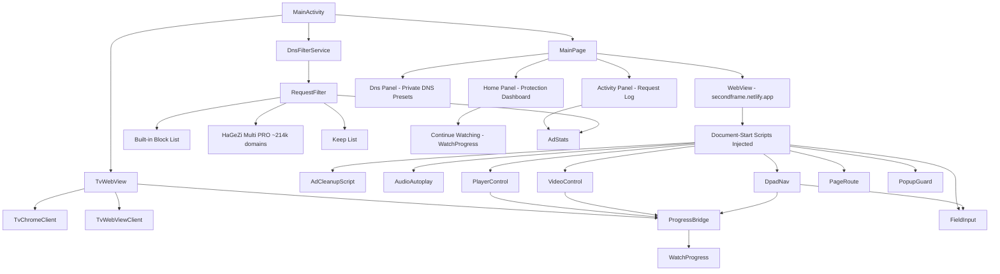

# Un0Tv Solution Map

## Overview
**Un0Tv** is a .NET MAUI Android TV app that wraps the **secondframe.netlify.app** website in a full-screen, D-pad driven experience with built-in advert filtering at every layer.

---

## Architecture Diagram



---

## File Structure

```
Un0Tv/
├── Android-specific (Platforms/Android/)
│   ├── AdCleanupScript.cs       # In-frame advert cover remover
│   ├── AndroidManifest.xml      # TV leanback launcher, VPN service
│   ├── AudioAutoplay.cs         # Unmutes video at document start
│   ├── DnsFilterService.cs      # Whole-TV VPN DNS filter
│   ├── KeyPad.cs                # On-screen letter pad (when TV has no keyboard)
│   ├── MainActivity.cs          # Remote key dispatch, fullscreen, VPN flow
│   ├── MainApplication.cs       # MAUI app entry
│   ├── MediaPanel.cs            # Left-key panel: Home/Play/Pause/Next
│   ├── PopupGuard.cs            # window.open gate: allows sign-in, blocks ads
│   ├── ProgressBridge.cs        # JS ↔ App bridge (progress, keyboard, route)
│   ├── RequestFilter.cs         # Network-level ad/tracker blocker
│   ├── Resources/               # TV banner, styles
│   ├── TvChromeClient.cs        # Pop-up windows, fullscreen video
│   ├── TvWebView.cs             # WebView setup, script injection hub
│   ├── TvWebViewClient.cs       # Request interception for main page
│   └── VideoControl.cs          # Direct video element control in every frame
│
├── Shared (Un0Tv/)
│   ├── Activity.cs              # LogEntry + AdStats (UI thread safe)
│   ├── App.xaml / App.xaml.cs   # App shell
│   ├── AppShell.xaml / .cs      # Shell navigation
│   ├── DnsPresets.cs            # 8 Private DNS providers + VPN state
│   ├── DpadNav.cs               # Page highlight navigation script
│   ├── FieldInput.cs            # On-screen keyboard → page input
│   ├── Hagezi.cs                # Downloads/merges 5 HaGeZi lists → 1 file
│   ├── MainPage.xaml / .cs      # Home/Activity/DNS panels + WebView
│   ├── MauiProgram.cs           # DI, logging
│   ├── PageRoute.cs             # Reports site route to app
│   ├── PageScripts.cs           # Auto-play on watch pages
│   ├── PlayerControl.cs         # VidFast player commands + progress
│   ├── Un0Tv.csproj             # net10.0-android, packages
│   └── WatchProgress.cs         # Continue watching list (localStorage → app)
│
├── mrowser-main/                # (Separate Android project, not used by Un0Tv)
├── README.md                    # Full documentation
├── Un0Tv.slnx                   # Solution file
└── version.json                 # Version base for Nerdbank.GitVersioning
```

---

## Core Features Mapped to Code

| Feature | Main Files | How It Works |
|---------|------------|--------------|
| **TV Launcher** | `MainActivity.cs` `[IntentFilter(LeanbackLauncher)]`, `AndroidManifest.xml` banner | Appears on Android TV home screen |
| **Landscape + Keep Awake** | `MainActivity.cs` `ScreenOrientation.Landscape`, `WindowManagerFlags.KeepScreenOn` | Locked to landscape, screen never sleeps |
| **Home Protection Screen** | `MainPage.xaml/.cs` `HomePanel`, `DrawLayers()`, `ShowHome()` | Shield, 3 layer buttons, Continue row, Start |
| **Activity Log** | `Activity.cs` `AdStats`, `LogEntry`; `MainPage.xaml/.cs` `ActivityPanel` | Queue → UI thread drain → All/Blocked tabs |
| **D-pad Navigation** | `DpadNav.cs` (injected), `MainActivity.cs` `MoveFocus/ActivateFocus` | Highlight ring over clickable items |
| **Watch Progress** | `PlayerControl.cs` → `ProgressBridge` → `WatchProgress.cs` | VidFast events → localStorage → app settings |
| **Continue Watching** | `WatchProgress.Recent(3)` → `MainPage.DrawContinue()` | Top 3 titles with ≥15s watched, not 99% done |
| **Media Keys** | `MainActivity.cs` `DispatchKeyEvent` → `TvWebView.PlayerCommand` | Play/Pause/FF/Rewind → `VideoControl` in frames |
| **Movie Panel (Left key)** | `MediaPanel.cs` `Show()`, `MainActivity.cs` `DpadLeft` | Android buttons: Home, Play, Pause, Next (ep 90%) |
| **Search Typing** | `FieldInput.cs` + `KeyPad.cs` + `MainActivity` | OK on search → caret in box → TV keyboard or app pad |
| **Advert Filter - Network** | `RequestFilter.cs` + `Hagezi.cs` | Built-in 300 + HaGeZi 214k domains, keep list wins |
| **Advert Filter - In-Frame** | `AdCleanupScript.cs` (runs in EVERY frame) | Removes QR covers, robot walls, countdown layers |
| **Advert Filter - Pop-ups** | `PopupGuard.cs` (runs in EVERY frame) | Blank probe → stand-in; sign-in → allow; else → stand-in |
| **Auto-play + Sound** | `AudioAutoplay.cs` + `PageScripts.AutoPlay` | Unmute + play video; click site's play button |
| **Private DNS** | `DnsPresets.cs`, `MainPage.cs` `TryApplyPrivateDns` | 8 presets; tries secure settings, else copies + opens settings |
| **Whole-TV VPN** | `DnsFilterService.cs`, `MainActivity.StartVpnFlow()` | Local VPN intercepts DNS → DoH to AdGuard; blocks everywhere |
| **Back Button Logic** | `MainPage.HandleBack()`, `MainActivity.DispatchKeyEvent` | Keyboard → Fullscreen → Popup → Site history → App exit |

---

## Data Flow: Advert Filtering (3 Layers)

```
Request from page or player frame
         │
         ▼
┌─────────────────────────────────────┐
│ RequestFilter.Decide(url)           │
│ 1. Keep list? → Allow               │
│ 2. Blocker off? → Allow             │
│ 3. Built-in list matches? → Block   │
│ 4. HaGeZi list matches? → Block     │
│ 5. → Allow                          │
└─────────────────────────────────────┘
         │
         ▼
Blocked? → RequestFilter.Empty() (204 No Content)
         │
         ▼
AdStats.Record(host, blocked, label) → Activity log
         │
         ▼
In-frame: AdCleanupScript.sweep() every 700ms
         ├─ Floating overlay with QR/text → remove
         ├─ Full-frame robot wall → clearFrame + reload
         ├─ Countdown cover with X → press X → remove
         └─ Ad iframes by src → remove
         │
         ▼
Pop-ups: PopupGuard.window.open override
         ├─ Blank probe → stand-in object
         ├─ Google/Firebase/same-host → real window
         └─ Everything else → stand-in
```

---

## Data Flow: Watch Progress

```
VidFast player (in frame)
         │
         ▼ postMessage PLAYER_EVENT {currentTime, playing, tmdbId...}
         │
PlayerControl.js (in main page)
         │
         ├─ localStorage 'un0tvProgress' ← saveProgress()
         │
         └─ window.Un0TvNative.saveProgress(json)
                    │
                    ▼
ProgressBridge.SaveProgress() (Android)
                    │
                    ▼
WatchProgress.Save() → Preferences (JSON list)
                    │
                    ▼
MainPage.DrawContinue() → WatchProgress.Recent(3)
                    │
                    ▼
Home screen: 3 cards with "XX min left", press → LoadDashboard + seek
```

---

## Key Design Decisions

1. **One WebView, one page** — No native re-rendering; the site is the UI
2. **Scripts at document-start in EVERY frame** — Reaches player frames where ads live
3. **Queue + UI-thread drain** — Filter runs on browser threads; UI updates on heartbeat
4. **Keep list always wins** — Site, sign-in, video hosts never blocked
5. **Whole host matching only** — `adsite.com` blocks `x.adsite.com`; never substring
6. **Android views for critical controls** — Media panel, KeyPad = D-pad reachable
7. **ProgressBridge = only JS→App bridge** — No arbitrary commands from page
8. **VPN only routes DNS (10.0.0.1)** — Content flows normally; no MITM

---

## Build & Run

```powershell
# Debug (fast, unsigned)
dotnet build Un0Tv/Un0Tv.csproj -f net10.0-android -c Debug

# Release (signed with un0tv.keystore + signing.props)
dotnet publish Un0Tv/Un0Tv.csproj -f net10.0-android -c Release

# Install on TV (ADB over network)
adb connect <TV-IP>:5555
adb install "Un0Tv/bin/Release/net10.0-android/publish/com.DevLink.Un0tv-Signed.apk"
```

---

## Versioning

| File | Purpose |
|------|---------|
| `version.json` | Base version (e.g., `1.5`) |
| `Nerdbank.GitVersioning` | Stamps `ApplicationDisplayVersion` from git |
| `Un0Tv.csproj` `ApplicationVersion` | Integer that MUST increase every install (currently 6) |

---

## Known Limits (from README)

- Player frame cannot be styled — site layout is phone-first
- Advert covers change — new wording slips through until added
- Private DNS may need manual step — Android restricts secure settings
- Burned-in QR/logo in video — cannot be removed by any app
- Typing depends on TV — some only show keyboard after real touch
- Single site — scripts tuned to secondframe markup

---

*Generated from codebase analysis — Un0Tv 1.5.0*